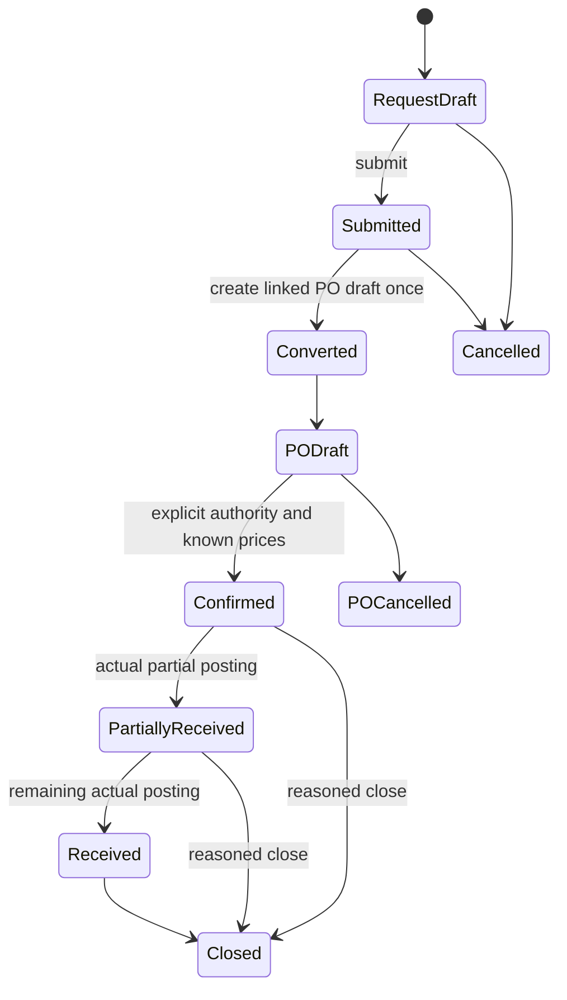

# Purchasing architecture

Purchasing extends the existing FastAPI/SQLAlchemy/PostgreSQL, authentication, same-origin BFF and audit architecture. Phase 3 customer LPO references remain entirely distinct from AMBS supplier purchase orders. No second inventory ledger or balance cache is introduced.

## Documents and relationships

Eighteen tables are added by `0005_purchasing`: suppliers, supplier_contacts, supplier_materials, supplier_quotations, supplier_quotation_lines, purchase_requests, purchase_request_lines, purchase_orders, purchase_order_lines, purchase_receipts, purchase_receipt_lines, production_orders, production_stages, production_events, production_costs, supplier_schedule_updates, production_conversions and purchasing_import_keys. Supplier, item, unit, warehouse, location, lot, user and movement references use UUID foreign keys. Generated document codes are stable; UTC creation/update timestamps and actor references are retained.

Commercial line descriptions, ordered quantities, units and prices are frozen after confirmation/issue. PostgreSQL triggers prevent editing/deleting confirmed lines and commercial terms, posted receipt history, started routes and append-only business events. Master item identity/unit precision cannot change after confirmed purchasing commitments. Decimal quantities use NUMERIC(20,6); prices/values use exact Decimal and NUMERIC storage. The browser sends decimal strings and never computes stock.

## Requests and purchase orders

Requests record employee/date/priority/reason, optional required date/quotation and explicit stock/service lines. Conversion preserves requested item/type/unit/quantities and creates exactly one linked PO; the request becomes CONVERTED when its draft PO is created. Cancelling that PO does not silently reopen the original request. Create a reviewed new request/PO where a new obligation is needed. No managerial approval hierarchy is imposed.

POs have supplier, optional quote/request, order/agreed expected dates, receiving warehouse, currency, notes and commercial lines/charges. Draft is not a supplier obligation or incoming stock. Confirmation requires actual unit prices and records the confirming actor/time. Unknown dates remain unknown. Stock lines must use the item's inventory unit; supplier catalog/quotation units can differ as information but cannot silently convert into stock. Service lines have a description/unit/quantity/price and no stock item.

Amendment closes an open order's unreceived remainder with a reason and creates a new linked replacement draft. It never edits historical received quantities/prices, and the replacement must be confirmed separately. Closing an order stops receiving; original unreceived quantities remain visible as closed remainder. Active linked production must be resolved before amendment/closure. Draft deletion and silent commercial changes are not supported.

## Receiving, transactions and costs

Receipt headers/lines are business links to the existing stock ledger. They capture actual time, actor, quantities, lot/disposition, source reference and exact PO-line identity. Draft receiving has no stock effect. Posting locks the authoritative order and checks the sum of already posted receipts plus every requested line against its ordered quantity. Service acceptance updates purchasing progress without any stock movement. Stock receiving uses private PURCHASE_RECEIPT movements and signed Phase 4 effects in one transaction. See PURCHASING_INVENTORY_INTEGRATION.md.

Outstanding = ordered quantity − posted, unreversed receipt quantity for an open confirmed obligation. DRAFT/CANCELLED/CLOSED orders expose no expected open incoming quantity; closed remainder remains explicit. Status advances to PARTIALLY_RECEIVED/RECEIVED from actual receipt totals. No over-receipt exception is silently accepted.

Existing security lock 7140284201 and inventory advisory transaction gate 7140284202 remain. Row locks and the same deterministic inventory bucket locking/NULL-aware uniqueness protect concurrency and new buckets. Unique UUID create/post/reverse/event keys and canonical hashes provide safe retries; stale draft versions fail. Multi-line business/stock/audit changes commit together, and failures roll back together. The conservative gate is a small-team throughput tradeoff that needs measured tuning before large-scale use.

PO unit prices are commitments, distinct from quotes, indicative stock value, processing charges and future invoices. Known comparable quote/PO unit variances are shown without FX/unit/quantity inference. Receiving uses the frozen PO unit price as its recorded cost basis. Freight/taxes/fees and outsourced charges remain separate unless a business-approved allocation is supplied in a later reviewed workflow. Processing charges/corrections are append-only, currency-specific, cannot make their currency total negative, and are labeled pending allocation. They are not automatically capitalized twice. No invoices, payments, VAT journals or accounting ledger is implemented.

## API

All routes below use `/api/purchasing` and existing session/Origin/JSON/CSRF controls:

- GET dashboard; GET options/{suppliers,items,units,warehouses,locations,lots,orders,production,quotations,requests}.
- GET list/detail for suppliers, contacts, catalog, quotations, requests, orders, receipts, production, transfers, schedules, custody-locations, conversions.
- POST suppliers/contacts, PUT suppliers/{id}, contacts/{id}, catalog.
- POST/PUT quotations, requests, orders and production drafts (PUT includes identity and current version).
- POST quotations/{id}/{issue,cancel}, requests/{id}/{submit,cancel}, orders/{id}/{confirm,close,cancel}; POST orders/{id}/amend with reason/replacement draft.
- POST receipts; POST receipts/{id}/{post,reverse,cancel}.
- POST stages/{id}/{start,complete,transfer,yard}; POST production/{id}/cancel for unstarted drafts; POST production/{id}/costs.
- POST/PUT custody-locations; POST conversions; POST schedules; POST compare; POST import-preview.

Lists support bounded search, applicable supplier/item/status/classification filtering, sorting and pagination. Orders additionally support open_only. Views currently assemble matching histories before pagination; optimize SQL aggregation and query counts before large imports. Bodies are bounded to 64 KiB, commercial/receipt lines to 30, conversion inputs/outputs to 15 each and planned stages to 12.
